# MCGB navigation and design audit — 19 October 2026

The main defects were unnecessary page sections, unclear responsibilities between pages, and inconsistent layout rules. The previous redesign replaced some of the old draft’s useful specificity with generic promotional language and repeated navigation. Changing its palette alone would not have resolved those problems.

This refinement uses ECC’s frontend design direction/accessibility checks and Product Design’s screenshot audit. The browser evidence was captured during this audit, before and after the changes. “AI-like” describes the visible design patterns below; it is not an authorship-detection claim.

## Scope and references

- Production before this audit: `9f7184b`, https://bostonmindfulness.vercel.app/. Rollback deployment: `dpl_7tThJFqCH5wQP1Bw2DAqwPSppYyH`, https://bostonoldpath-45l4kvmt2-mindfullybuildings-projects.vercel.app.
- Pre-migration draft: `4c70a36`, tag `mcgb-pre-redesign-2026-10-19`, preserved source under `design-prototypes/archive/2026-10-19-live/`. Served locally for fresh browser captures. Home, finder, practice, community, and resource layouts were compared directly.
- Copy reference: user-supplied `outputs/photos-transcription/review.html`, especially Peaceful Garden’s practice and community materials. The private review file and source photographs remain excluded from Git and deployment.
- Comparator: [Cambridge Zen Center](https://www.cambridgezen.org/), desktop and phone homepage/navigation, plus the About page encountered while exercising navigation. This was not a complete WCAG audit of CZC.
- MCGB coverage: all 17 first-party HTML pages, complete core journeys, default/open/error states, desktop and phone visual review, and eight responsive widths.

## Findings and implemented corrections

| # | Finding before refinement | Effect | Revision |
| --- | --- | --- | --- |
| 1 | Main navigation placed Our practice inside Resources; New here was prominent without a clear relationship to the practice page. | Core explanatory pages were harder to find than generic entry prompts. | Direct main links: Our practice, Our community, Events, Resources, Mailing lists; prominent Find a group. New here belongs to the practice section and remains directly available in the homepage hero. |
| 2 | Tiny Unicode dropdown marks touched their labels; open triggers used a rounded pale background unlike adjacent links. | The header looked assembled from unrelated controls. | Removed the unnecessary dropdown layer and arrows. Used ordinary 16px direct links. Phone menu/close icons come from Lucide, with accessible names and 44px controls. |
| 3 | Six homepage sections repeated group, practice, resource, newcomer and connection invitations under different labels. Numbered cards implied a sequence that did not exist. | More scrolling and decisions without more useful information. | Four substantive sections. Removed numbering, the generic “living tradition” block, repeated newcomer callout and second resources promotion. Each route has one linked title and a short description. |
| 4 | The homepage’s middle used a vertically centered photo/text split, then differently aligned copy/callout pairs. | Headings and content started at unrelated heights. | Removed the redundant photo feature; remaining parallel columns align at their top edges. Newsletter imagery now represents an actual issue, with a clear archive destination. |
| 5 | Nearly every heading used large Georgia type; all body text was dark blue, supporting text medium blue and main headings another blue. | Reading pages, directory tools and navigation lacked a clear typographic hierarchy. | System sans serif for interface and reading; Georgia only for the greeting. Black/white text. Controlled H1/H2/H3 sizes, consistent measures and paragraph gaps. |
| 6 | Gold header, yellow actions, several blues, rounded cards and rule-heavy callouts competed. | Too many visual signals for a small community site. | Accessible Continental Blue companion banner and primary controls; white header button; neutral surfaces and rules. Removed gold UI, colored heading scale and decorative shadows. |
| 7 | Section padding accumulated through several late CSS overrides. Some section headings followed buttons with almost no separation; other sections had large empty margins. | Inconsistent rhythm and avoidable reflow risk. | Replaced the override stack with one shared component stylesheet. Standard 48px/40px sections, 20px paragraph gaps, 40px reading subsections, named directory/hero exceptions. |
| 8 | The redesigned finder became a two-column card catalog with an expanded sidebar; organizer contact was hidden in details. Map and calendar moved far below discovery. | A successful original task layout was lost. | Restored filter/list/map-calendar composition, a single list, explicit Day/Time/Location labels, collapsed filter categories and visible organizer contacts. Added the public agenda in the original right-rail role and the full subscription guide below. |
| 9 | Community overview became a generic lineage/directory/promotion page, replacing the existing explanation of MCGB. | The standalone page’s actual purpose became unclear. | Restored the original community paragraphs and meaningful resource/event links. Retained Togetherness in community context. |
| 10 | Community Voices duplicated the newsletter gallery, while the archive and mailing subscription were repeatedly cross-promoted as if interchangeable. | Several paths seemed to offer the same content. | Voices owns submission instructions and the form. The archive owns three real PDF editions. Mailing lists owns the two subscription processes. Community local navigation connects these distinct tasks. |
| 11 | Some resource entries opened placeholder material or said “not available.” | Non-working actions looked like real services. | Removed empty resource cards. Consolidated builder/mentoring/listing questions into one honest email route, preserving old anchors. Existing five facilitator documents remain separate pages. |
| 12 | Guide pages lacked a clear parent route; inconsistent related links made movement between documents less predictable. | Readers could lose their place in the resource library. | Added a working Resources → Sangha resources breadcrumb and one consistent set of sibling links, excluding the current page. Removed repeated path labels and duplicate related-navigation blocks. |
| 13 | Phone drawer listed ten destinations, mixing primary destinations with selected children. | Mobile hierarchy differed from desktop and required extra scanning. | Six primary destinations in matching order. Section navigation appears on the relevant pages. Drawer scrolls in short windows and restores focus. |
| 14 | The oversized blue footer repeated most of the primary navigation and added more reassuring prose. | Another large, redundant section at the end of every page. | Compact organization identity and four utility destinations: Contact, Accessibility, Photo credits, Privacy & site information. |

## Numbered journey review

| Step | Journey and current health | Evidence |
| --- | --- | --- |
| 1 | Home orientation — revised. Original greeting and introductory wording restored; explicit practice/community/resource routes; redundant sections removed. | Before/after home and pre-migration captures below. |
| 2 | Desktop and phone navigation — passes tested tasks. Matching direct destinations, working menu icon, modal keyboard containment, Escape, focus restoration and responsive focus movement. | Navigation tests, drawer captures. |
| 3 | Find a sangha → filter → details/contact — passes. Thirteen preserved records; original layout restored; contacts available without opening details. Phone toggle moves before the filters and changes to Hide filters while open. | Finder captures and Chromium/WebKit interactions. |
| 4 | Events → public agenda → subscription guide — passes first-party tasks. Correct anchor, clear separation from regular sangha schedules, copy fallback, six provider guides, empty/error/refresh recovery. | Calendar state and navigation tests. Google sign-in view remains optional and closed. |
| 5 | Resources → each standalone guide → parent — passes. Actual document URLs, resource anchors, sibling routes and source text retained. | Navigation tests exercise all five guide journeys. |
| 6 | Our community → Voices → form / archive → PDF — passes the website handoffs. Submission and historical reading have different destinations. No automatic publishing or file-upload promise. | Community/Voices/archive captures, form destination and actual PDF request checks. |
| 7 | Mailing lists → correct subscription request — passes website handoff. Two original addresses retained; sending and Groups.io confirmation remain user actions. | Mailing page and navigation tests. No emails sent or test subscriptions created. |
| 8 | Reading/support pages — passes tested first-party checks. Consistent typography, heading structure, reading measures, utility links and truthful limitations. | Seventeen-page scans, link/anchor audit, enlargement and reading captures. |

## Navigation and preserved pages

The pre-migration site had 12 canonical HTML pages. Their URLs remain available: home, our-practice, our-community, resources, find-a-sangha, newsletters, join-mailing-list, sangha-overview, sangha-facilitation, minding-the-bell, meeting-and-bell-minding-flow, and dharma-sharing-guidelines. Feedback filenames continue to resolve to canonical destinations.

The issue was broader than missing URLs: the previous redesign changed what overview pages contained and made older destinations harder to recognize and reach. This revision restores the useful page responsibilities and tests the links between them. It does not combine the five guides into Resources, place the archive gallery on Voices, or turn the community overview into another group finder.

```text
Home
├── Our practice
│   └── New here → Find a group → Organizer contact
├── Our community
│   ├── Community Voices → Contribution form
│   ├── Newsletter archive → Historical PDFs
│   └── Togetherness (external)
├── Events → Find a sangha #calendar → Subscription guide
├── Resources → Categories → Standalone guides / external teachings
├── Mailing lists → Two separate subscription addresses
└── Find a group → Filters / details / organizer / regional map
```

Contextual links are retained where they complete a task. Repetition is deliberate only when it provides a useful entry point—for example, the header Find a group action and the newcomer guide’s final route to the directory. The footer no longer duplicates the primary menu.

## What CZC does better, and what not to copy

CZC’s strongest advantage is specific material: photographs of its actual building, people and practice; concrete program names; an immediately recognizable organizational identity. Its images explain what participation looks like. MCGB’s original introduction and actual newsletter material serve that same purpose better than invented mood-setting copy.

CZC also makes major destinations obvious. MCGB adopts that directness while simplifying its own shallower hierarchy. It does not need menus merely because CZC has them.

Measured at 1440px, CZC’s header was approximately 62px high. Top-level navigation ranged from 12.8px to 14.27px; sampled child links were 12.8px with about 16.64px line-height and 1.28px vertical padding. Those small/compact proportions are not the target for MCGB. ArrowDown did not expose the About submenu in the tested state; activating About navigated to the About page. This is an observation about the tested path, not a complete keyboard assessment of every CZC menu.

CZC’s phone navigation is visually straightforward, but its homepage remains long, and its social section showed a large unfilled area in this session. Its large photo hero and ornamental alternating content timeline should not be copied wholesale. MCGB retains a content-sized photo hero and useful real material without filling every section with a photo or new interface treatment.

Actual Boston community photography is still a content gap. The retained landscape is not represented as a local gathering, and licensed lineage photographs are accurately identified. No community photographs or submissions were invented.

## Color decision

The banner now uses **#3276C2**, a slightly darker, explicitly documented companion to Continental Blue **#367BCA**. This preserves the brighter blue direction without reverting to CZC’s navy.

| Combination | Calculated contrast | Use |
| --- | --- | --- |
| White / exact Continental Blue #367BCA | 4.34:1 | Insufficient for ordinary white navigation text |
| White / companion #3276C2 | 4.66:1 | Header navigation and primary page controls |
| Black / white | 21:1 | Body, headings, links, captions and white buttons |
| White / brightest possible hero pixel after 64% black scrim | 6.71:1 | Greeting, introduction and hero link |

All first-party text uses black or white. Links remain identifiable by underline, selected items have visible text treatment, and focus has contrasting black/white boundaries. Photography keeps its natural colors. The [Boston color reference](https://www.flagcolorcodes.com/boston) is a third-party flag reference, not an official website-branding standard.

## Copy and design governance

`DESIGN.md` now records the navigation map, each page’s job, palette roles, type hierarchy, spacing, top alignment, meaningful icon use and page exceptions. It explicitly bans generic AI filler, invented slogans, numbered non-sequences, needless nested cards, unsupported participation promises, fictional history, and duplicate promotional sections.

Material copy changes in this refinement:

- Restored the original greeting and introduction. The introduction is split between the hero and following section without changing its meaning.
- Restored the pre-migration community explanation and its actual destination links.
- Replaced generic practice marketing copy with attributed extracts from the supplied Peaceful Garden materials. Group-specific schedule/donation promises were not generalized.
- Simplified newcomer guidance to one reading flow and one directory action, retaining practical questions and access caveats.
- Kept factual submission, subscription, calendar and PDF access instructions. Removed filler and duplicate galleries, rather than silently rewriting the source teaching text.

## Verification and limits

Results are versioned alongside this report:

- `automated.json`: 17 first-party pages × 8 widths (320, 390, 430, 768, 820, 1024, 1280, 1440); no first-party axe violations or horizontal document overflow in these checks.
- `navigation.json`: six complete journey groups in Chromium 148.0.7778.96 and WebKit 26.4, including all five guide/return paths.
- `interactions.json`: keyboard/skip link, drawer containment/Escape/resizing, filters, no matches, contact, resource anchors, calendar pagination, inert descriptions, multi-day dates, refresh failure retaining results, clipboard failure, reduced motion, spacing and short-window checks. Google Maps’ runtime is blocked in this first-party suite and tested separately.
- `states.json`: seven open/default/error scans, plus blocked map/calendar alternative-content checks.
- `enlargement.json`: all 17 pages at 390 and 1440px with doubled computed text sizes; no horizontal document overflow.
- `links.json`: 17 pages, 27 internal destinations and 68 anchor references; no issues.
- `background-hero.json`: contrast, photo failure, forced colors and print checks.
- Build, lint and five calendar parser/cache/recurrence tests passed. No-JavaScript primary content/navigation, directory contact and resource links passed.

**These are first-party results, not full-page WCAG certification.** `third-party.json` includes the anonymously loaded Google map. It found four serious rule categories: 10 unlabeled controls, 4 prohibited ARIA attributes, one contrast issue and one target-size issue in that rendered session. An additional WebKit interaction run encountered a Google map loading error; first-party behavior was then isolated from that external runtime and retested. Map findings are not discarded or marked fixed. The public accessibility statement identifies the limitation. The complete directory, schedules and organizer contacts are independent of the map.

Google Calendar remains an optional signed-in view, not the public agenda. No private Google account/settings were accessed during this audit. The contribution destination was checked as a handoff; this audit did not submit work or certify Google Forms’ complete process. Historical PDFs remain unremediated. Native VoiceOver, NVDA, TalkBack and iOS VoiceOver checks were not performed; WebKit is not a substitute for a real screen-reader evaluation. No independent certificate or sitewide compliance badge is claimed.

## Visual evidence

Screenshots below are unedited current-run captures. Full-size files are in `screenshots/`. Additional captures of every revised first-party page remain in the local `outputs/refinement-audit-2026-10-19/after/` inventory.

### 1. Homepage before refinement

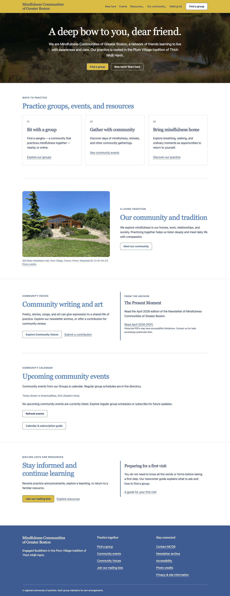

### 2. Pre-migration homepage and finder

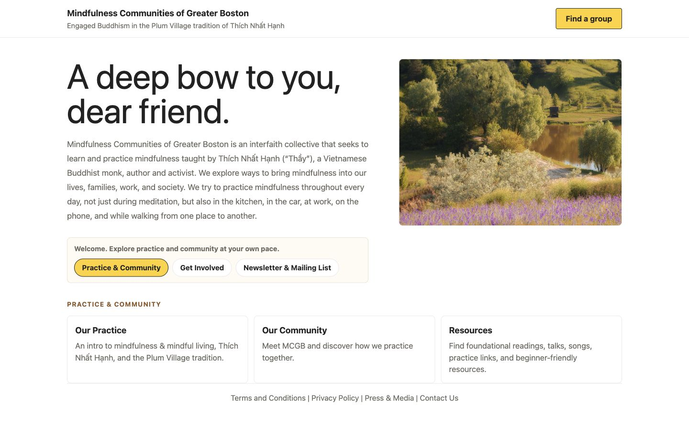

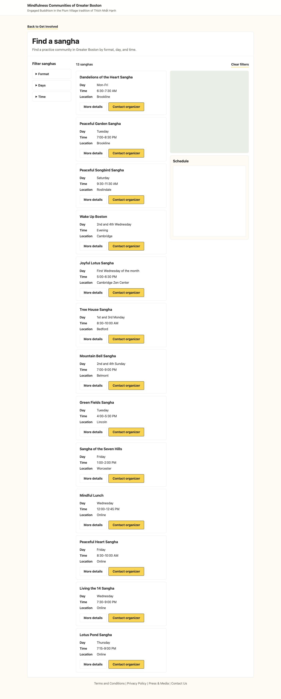

### 3. Comparison reference

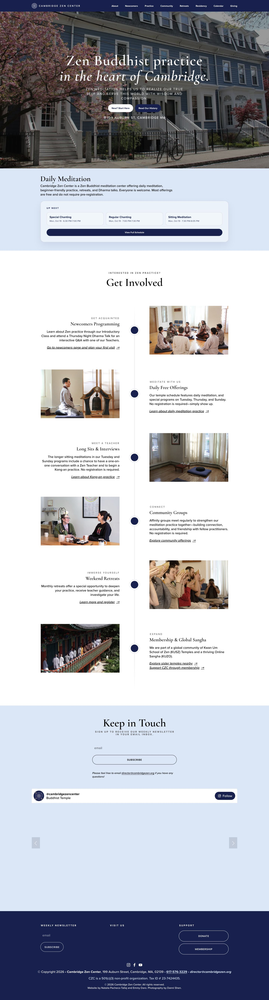

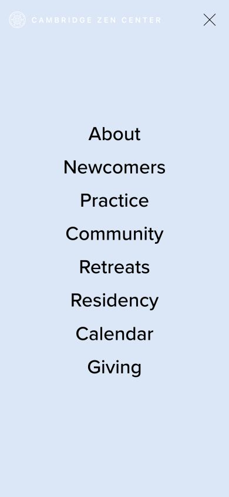

### 4. Revised homepage and phone navigation

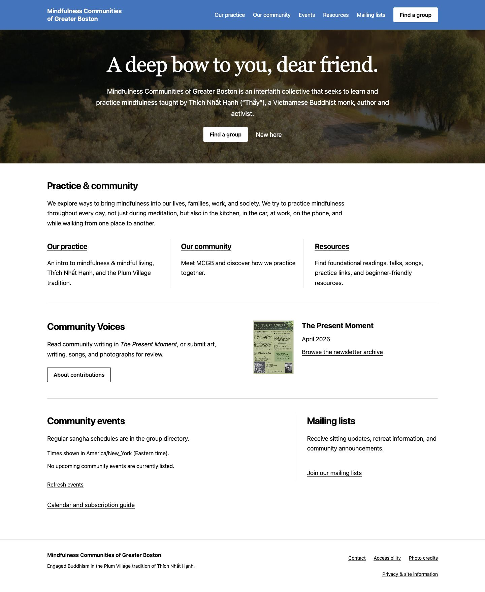

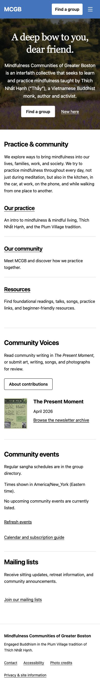

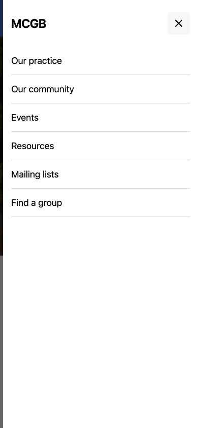

### 5. Restored finder and clear resource paths

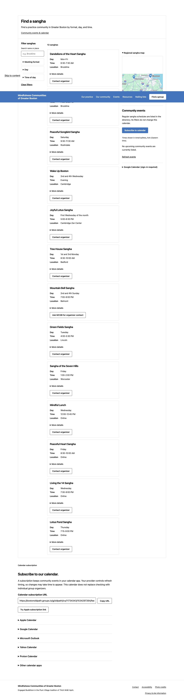

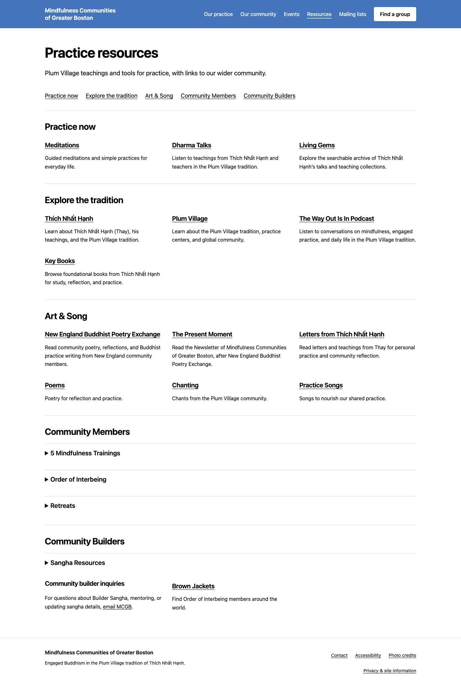

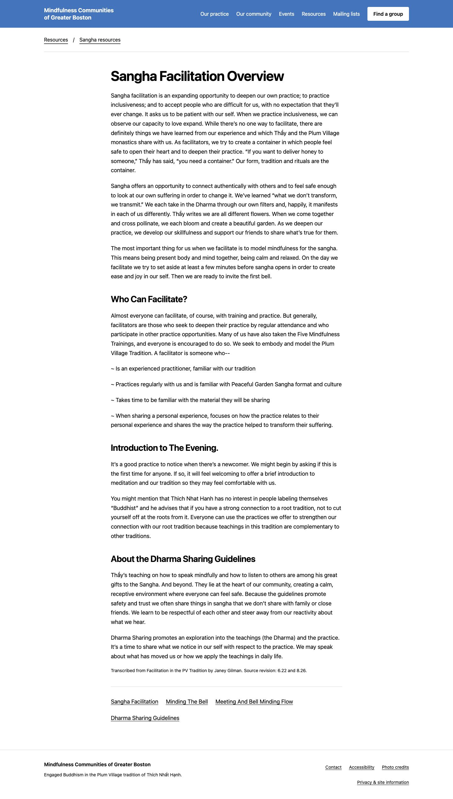

### 6. Distinct community and newcomer pages

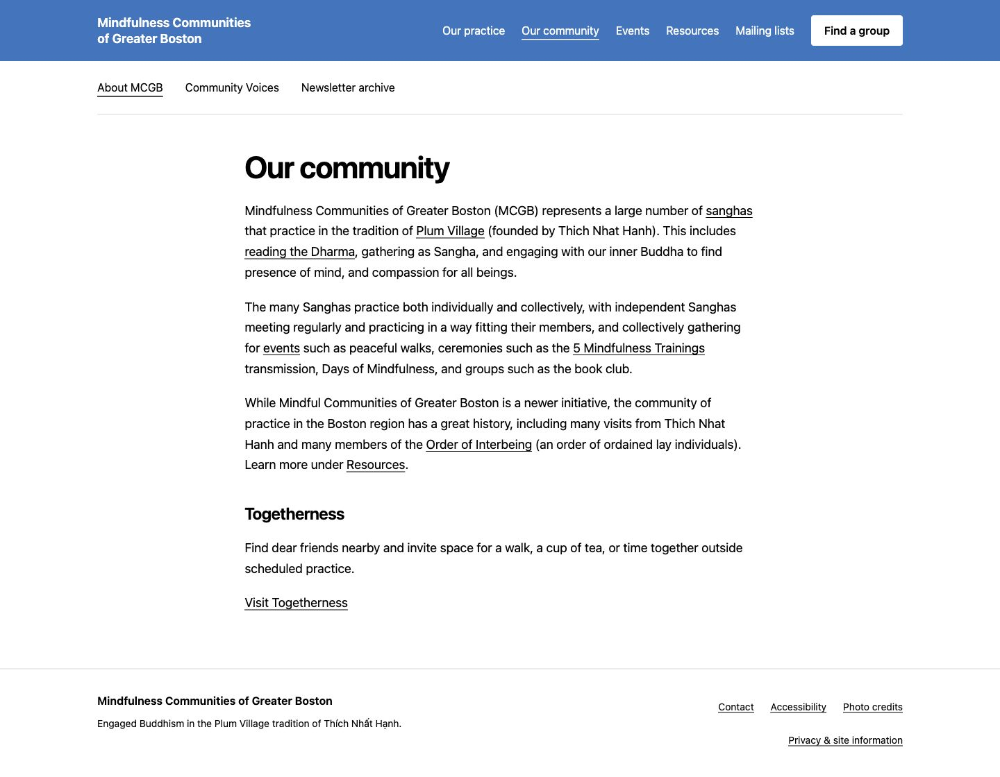

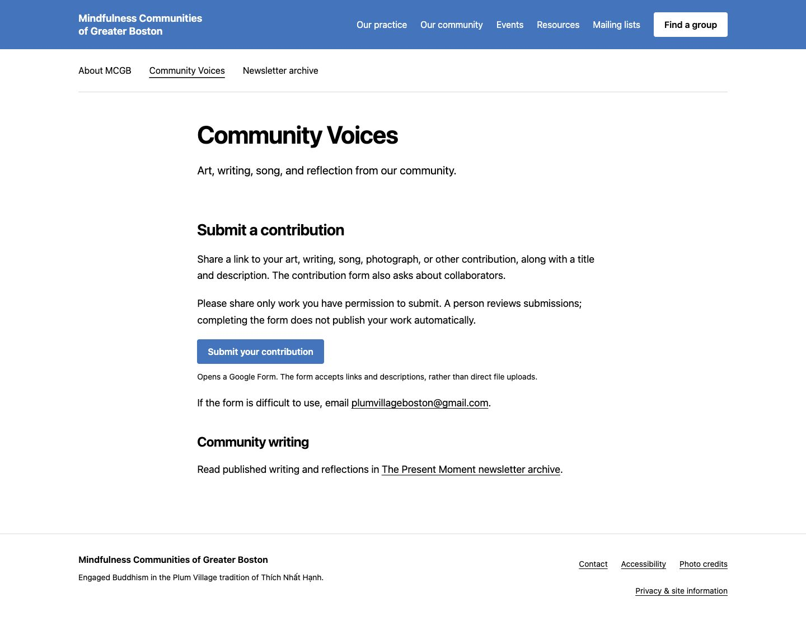

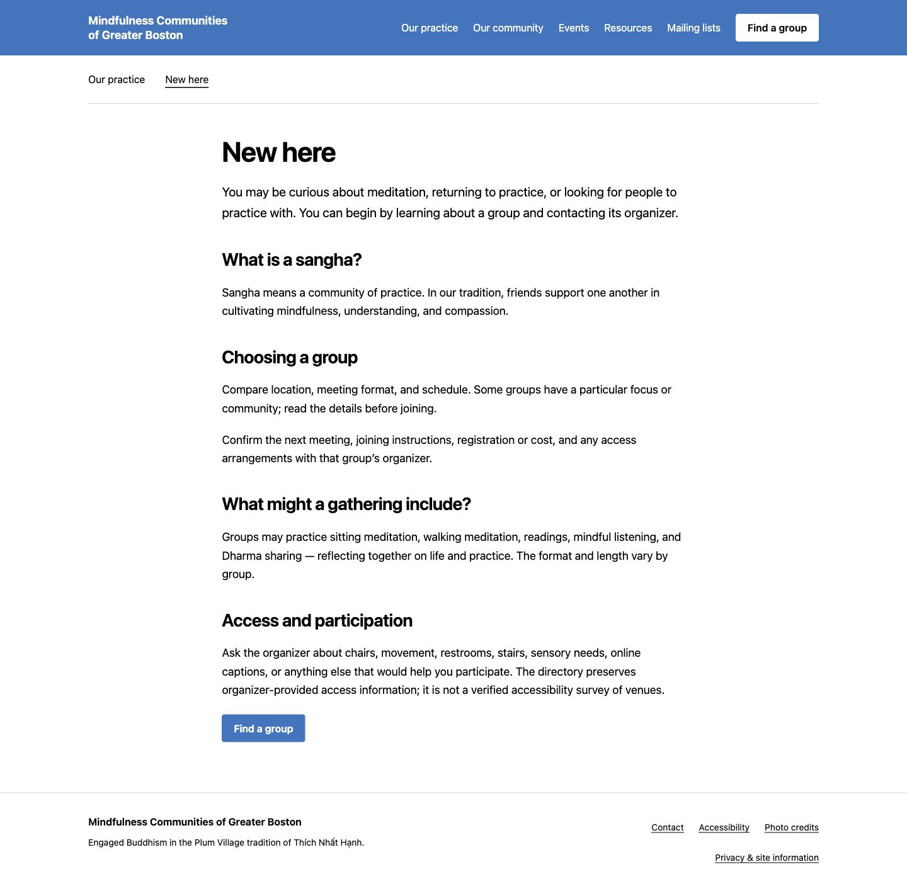

## Release preservation

The pre-migration snapshot/tag remains intact, and the previous live revision/deployment is recorded above. No public archive link was added. Local meeting materials, transcription review, raw photographs, secrets and generated test output remain excluded. Versioned audit evidence and tests are also excluded from the Vercel upload; they are not needed by the production build.

Release procedure: push the verified revision to GitHub main, deploy explicitly to the existing `bostonoldpath` Vercel project, then verify the public `bostonmindfulness.vercel.app` alias. Final production ID/source revision and smoke results are recorded in the local `outputs/refinement-audit-2026-10-19/release.json` after deployment. The final response identifies the deployed revision.
